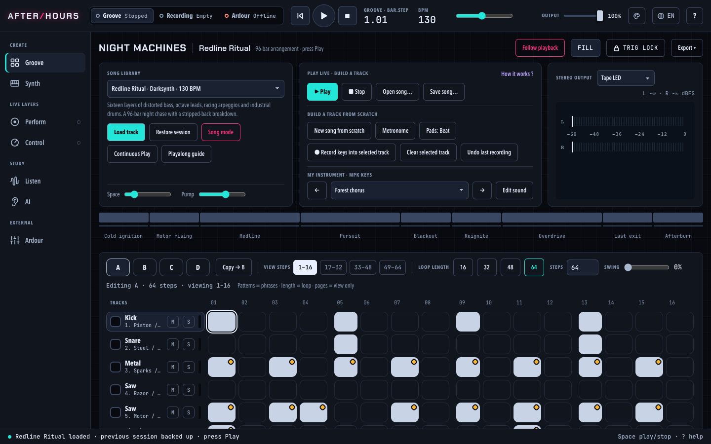
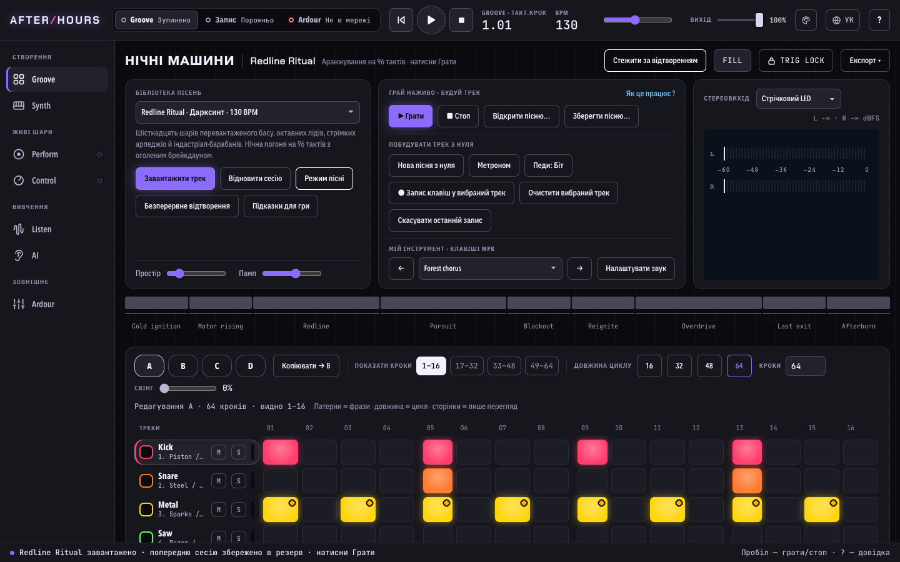
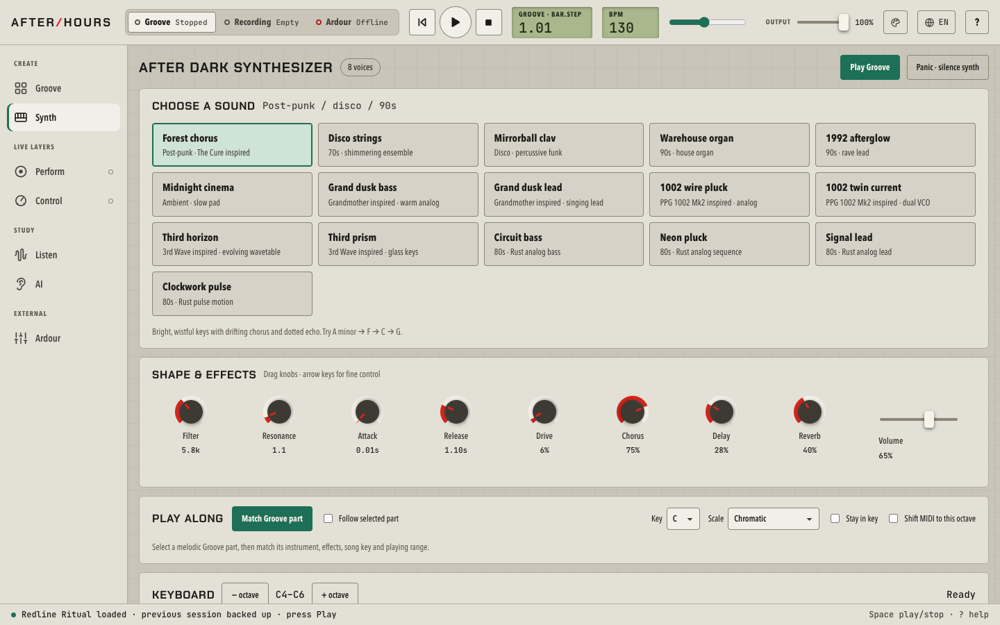

# AFTERHOURS

[Website](https://desperado.github.io/afterhours-oss/) · [Download for macOS](https://github.com/Desperado/afterhours-oss/releases/latest) · [Public CI](https://github.com/Desperado/afterhours-oss/actions/workflows/ci.yml)

A local music studio for sequencing songs, playing synths, recording performances and studying recordings. Build sixteen-lane Groove arrangements, play a keyboard or USB MIDI controller, shape the mix, and export projects, MIDI and WAV audio. Listen and AI add waveform playback, loops, local measurements and optional paid musical feedback.

It runs on your Mac, in a browser or as a standalone desktop app. Nothing leaves the machine unless you press **Send** on a paid AI listen.



## Get it

**Desktop app (Apple Silicon).** Download the DMG or app ZIP from [GitHub Releases](https://github.com/Desperado/afterhours-oss/releases/latest). It includes the Python runtime and audio libraries, so it needs no terminal, Python or Node. The binaries are ad-hoc signed without Apple notarization, so macOS may block the first launch. See [the desktop app](docs/desktop.md).

**From a checkout.** Install Python 3.11 and Node.js, then:

```sh
npm run setup
bash start.sh
```

Open **http://127.0.0.1:8765**. `bash start.sh --port 8766` uses another port; `npm run desktop` opens the desktop shell instead. See [development](docs/development.md) for builds, checks and private content.

## First session

1. Open **Groove**. In **Song library** choose **Neon Afterimage**, press **Load track**, then Play. This synth arrangement works without downloaded instrument recordings or an API key.
2. Open **Synth** and play the on-screen keys or the computer keyboard (**A W S E D F T G Y H U J K O L P**, **Z / X** for octave).
3. Open **Perform** to record a take, connect USB MIDI, recall scenes and mix lanes. Open **Control** to shape the whole sound live. Both dock above whichever workspace is open.
4. Open **Listen** to import and loop a recording. In **AI**, **Local scan** measures an excerpt on this Mac; paid listening is optional and shows the cost before sending.

**Space** plays or stops the active engine and **?** opens the help sheet.

## What is in it

| Area | What it does | Guide |
| --- | --- | --- |
| **Groove** | Sixteen-lane step sequencer with twelve synthesized machines and sampled instruments, patterns, per-step locks, song arrangements, a library of original tracks, MIDI overlay, and WAV, MIDI and project export. | [Groove](docs/guide/groove.md) |
| **Synth** | Polyphonic keyboard instrument with sixteen patches that can match a Groove part and stay in the song's key. | [Synth and Control](docs/guide/synth-and-control.md) |
| **Control** | A live sound layer over Groove, Synth and recording playback: tone, resonance, heat, movement, space, scales and tunings, with A/B snapshots. | [Synth and Control](docs/guide/synth-and-control.md) |
| **Perform** | Record and replay takes with gestures, named parts, eight macros, eight morphing scenes, a lane mixer, modulation routes, USB MIDI with MIDI Learn, and an experimental "play a phrase, add a band" jam. | [Perform](docs/guide/perform.md) |
| **MPK mini Plus II** | A ready profile for the Akai controller: pads, knob banks, display and lights, transport and guided learning. | [MPK mini Plus II](docs/guide/mpk-mini-plus-ii.md) |
| **Listen** and **AI** | Waveform player with A–B loops, speed and live effects; free local signal scans and optional paid listening through the OpenAI Audio API. | [Listen and AI](docs/guide/listen-and-ai.md) |
| **Ardour** (experimental) | Transport, mixer gains and a Surge XT sound editor for a separately installed Ardour build. | [Ardour](docs/guide/ardour.md) |

The strip, rail, themes and languages are described in [the interface](docs/guide/interface.md).

## Languages and themes

The globe chip in the top bar switches between **English** and **Українська** without reloading. The palette chip changes the colours: **Night** is the default, and seven more looks are inspired by classic samplers, pad controllers and grooveboxes. Both choices are remembered on this device.

| Pad Grid theme, Ukrainian | Sampler 60 theme |
| --- | --- |
|  |  |

## How it is built

The backend is Python; the interface is plain HTML, CSS and JavaScript with no build step. It reuses the [music-analysis skill](.agents/skills/music-analysis/SKILL.md) and its librosa, NumPy, SoundFile and OpenAI audio pipeline. A modular Rust DSP core compiles to WebAssembly for the audio rendering thread; see the [DSP architecture and extension guide](dsp/README.md). The desktop app is an Electron shell around the same interface.

More documentation:

- [Development](docs/development.md): setup, checks, CI, desktop builds, adding themes and translations.
- [Content packs](docs/content-packs.md) and [release readiness](docs/open-source-readiness.md).
- [Instrument recordings](web/instruments/README.md#local-installation-and-native-packaging): sampled instruments need separately installed recordings.
- [Performance measurements](docs/performance.md) and the [Червона рута · Orchestra](docs/chervona-ruta.md) adaptation.
- [Native Ardour build](scripts/ardour/README.md).

## License

Original AFTERHOURS software and documentation are licensed under [Apache-2.0](LICENSE). See [NOTICE](NOTICE), [third-party licenses and media exclusions](THIRD_PARTY.md), and [contributing](CONTRIBUTING.md). Fonts, instrument recordings and the Ardour patch retain their own terms. Reference songs, reconstructions and uncleared artwork are outside the Apache grant.

The public repository excludes private reference content. Configured local builds can include a separately installed private pack; see [content packs](docs/content-packs.md) and [release readiness](docs/open-source-readiness.md).
